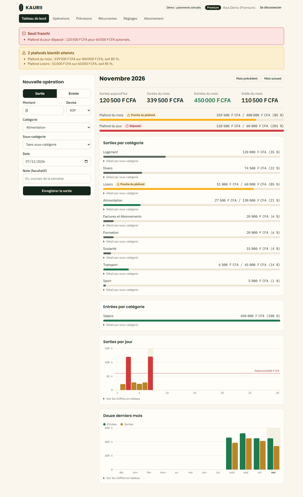
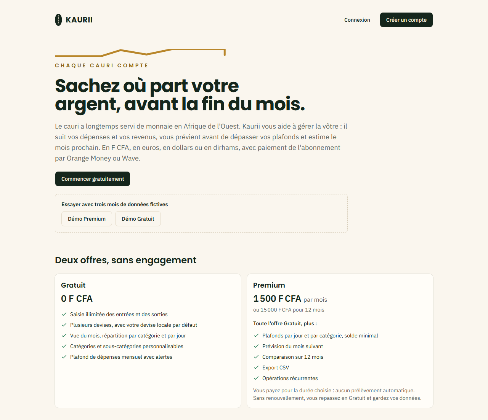
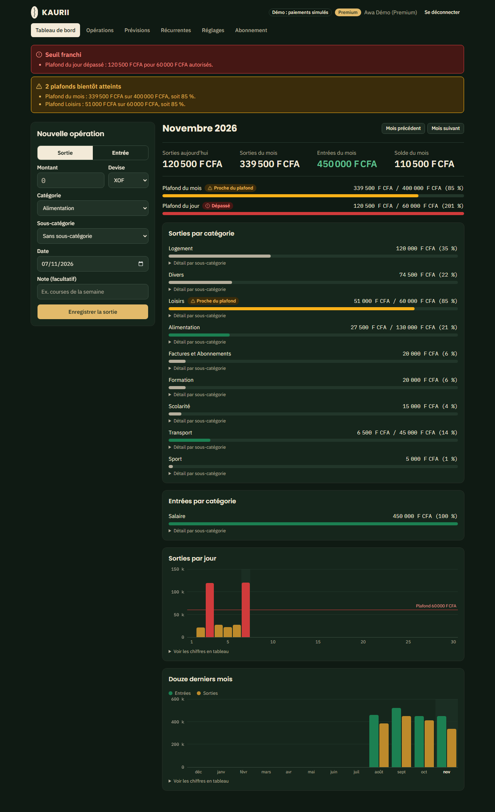
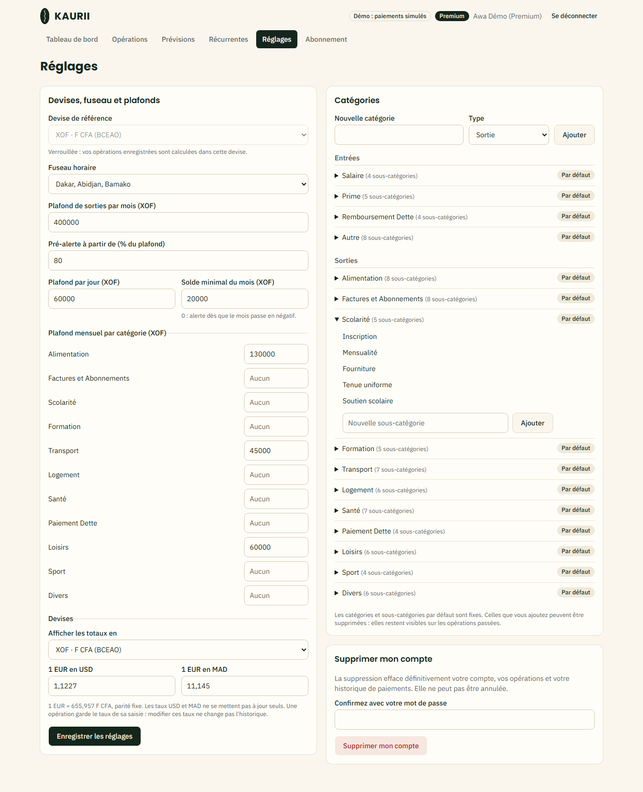
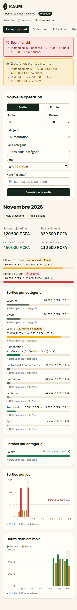
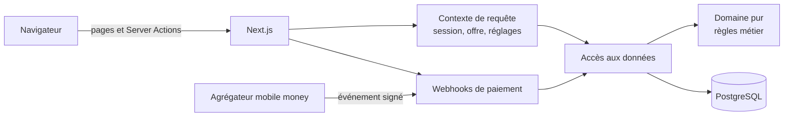

  <picture>
    <source media="(prefers-color-scheme: dark)" srcset="docs/brand/kaurii-logo-sombre.png">
    
  </picture>

# Kaurii

> **Chaque cauri compte.**

Kaurii est un SaaS de gestion de dépenses pensé pour les francophones, en particulier en Afrique de l'Ouest. On y suit ses entrées et ses sorties, l'application alerte avant le dépassement d'un plafond et anticipe le mois suivant. Elle gère plusieurs devises et utilise par défaut la devise locale. Le modèle est freemium : l'abonnement Premium est prépayé par mobile money (Orange Money, Wave).

Le nom vient du cauri, un coquillage qui a longtemps servi de monnaie en Afrique de l'Ouest.

> **Ce dépôt est une vitrine.** Le code source de Kaurii est dans un dépôt privé. Je peux en donner l'accès en lecture sur demande, pour un processus de recrutement par exemple ([voir Contact](#contact)).

| | |
|---|---|
|  |  |
|  |  |

## Le problème

Les applications de budget les plus connues sont pensées pour l'Europe et l'Amérique du Nord. Elles supposent une carte bancaire, ignorent le franc CFA et proposent des abonnements par prélèvement automatique. Or en Afrique de l'Ouest, l'argent du quotidien circule surtout en espèces et par mobile money, et le mobile money ne permet pas le prélèvement automatique.

Kaurii part de ces réalités : le franc CFA comme devise par défaut, des montants saisis à la française (`1 500`, `45,50`) et un abonnement prépayé qui se renouvelle comme un crédit de communication.

## Fonctionnalités

**Offre Gratuite**
- Saisie illimitée des entrées et des sorties, avec recherche et filtres
- Catégories et sous-catégories
- Cinq devises : F CFA BCEAO, F CFA BEAC, euro, dollar, dirham. La devise locale est détectée à l'inscription
- Vue du mois : totaux, solde, répartition par catégorie, sorties par jour
- Plafond de dépenses mensuel avec pré-alerte

**Offre Premium** (1 500 F CFA pour 30 jours, 15 000 F CFA pour un an)
- Plafonds par jour et par catégorie, solde minimal
- Prévision du mois suivant, calculée sur les trois derniers mois
- Comparaison des entrées et des sorties sur 12 mois
- Export CSV compatible avec les tableurs français
- Opérations récurrentes (loyer, salaire, abonnements)

L'interface est responsive, avec un thème clair et un thème sombre.

## Pile technique

| Besoin | Choix |
|---|---|
| Application | Next.js 16 (App Router, Cache Components), React 19, TypeScript strict |
| Interface | Tailwind CSS 4, shadcn/ui (Base UI), Lucide |
| Données | PostgreSQL, Drizzle ORM, migrations versionnées |
| Base locale et tests | PGlite (PostgreSQL embarqué, sans Docker) |
| Authentification | Better Auth (e-mail et mot de passe, sessions en base) |
| Validation | Zod |
| Tests | Vitest (unitaires et intégration), Playwright (bout en bout) |
| Intégration continue | GitHub Actions |

## Architecture

L'application est organisée en couches dont les dépendances sont contrôlées :

- **Domaine pur** : montants, devises, seuils, prévision, offres, CSV. Ce code n'importe ni framework ni base de données, et il est entièrement couvert par des tests unitaires.
- **Accès aux données** : chaque fonction reçoit l'identifiant de l'utilisateur et ne touche que ses propres lignes.
- **Application** : pages rendues côté serveur et diffusées en streaming. Les Server Actions revérifient la session à chaque appel.
- **Paiements** : une interface `PaymentProvider` pour brancher n'importe quel agrégateur. Tous les événements de paiement passent par un seul point d'entrée, idempotent et transactionnel.

## Choix techniques

Quelques décisions qui montrent comment le projet est pensé :

- **Des montants exacts.** Tous les montants sont stockés en entiers dans la plus petite unité de la devise (centimes, ou francs pour le F CFA). Il n'y a jamais de nombre décimal, donc jamais d'erreur d'arrondi.
- **Un historique immuable.** Chaque opération fige son taux de change et sa contre-valeur au moment de la saisie : modifier un taux plus tard ne réécrit pas le passé.
- **La sécurité au plus près des données.** Chaque requête est filtrée par l'utilisateur de la session, et chaque identifiant reçu du navigateur est vérifié comme lui appartenant. Les droits Premium sont contrôlés côté serveur, jamais seulement dans l'interface.
- **Aucune tâche planifiée.** L'offre se déduit d'une seule date de fin d'abonnement et expire d'elle-même. Les opérations récurrentes se génèrent à la lecture. Résultat : l'application tourne sur un simple hébergement mutualisé.
- **Des paiements robustes.** Les webhooks sont signés, et un même événement reçu deux fois n'est appliqué qu'une fois.

## Qualité et tests

| Niveau | Outil | Ce qui est vérifié |
|---|---|---|
| Unitaire | Vitest | Montants, conversions, dates, seuils, prévision, offres, CSV |
| Intégration | Vitest et PGlite, avec les vraies migrations | Isolation entre comptes, taux figés, récurrences, cycle de paiement |
| Bout en bout | Playwright sur le build de production | Parcours utilisateur, offres, abonnement, rendu mobile |
| Paquet de déploiement | Playwright, PostgreSQL 16 et Node 24 | Les mêmes parcours, dans les conditions du serveur |

L'intégration continue exécute le lint, la vérification des types et l'ensemble des tests à chaque demande de fusion.

## État du projet

Kaurii est en **version 0.1, en phase de test fermée**, et tourne en préproduction sur un hébergement Node.js avec PostgreSQL. Le cycle d'abonnement est complet, mais avec un fournisseur de paiement simulé : le projet n'encaisse pas encore d'argent réel.

Prochaines étapes : brancher un agrégateur de mobile money réel, l'envoi d'e-mails, les documents juridiques (CGU, confidentialité) et le suivi d'exploitation.

## Contact

**Mamadou FALL** · Staff Engineer @ Cegid · AI Platform & Developer Enablement

- 🌐 [mamadoufall.com](https://mamadoufall.com/)
- 💼 [linkedin.com/in/mamadoufallofficiel](https://www.linkedin.com/in/mamadoufallofficiel)
- 🐙 [github.com/mamadoufall-ia](https://github.com/mamadoufall-ia)

Pour une démonstration ou un accès en lecture au code source, contactez-moi.

---

© 2026 Mamadou FALL. Tous droits réservés. Le nom Kaurii, le logo et les captures ne peuvent pas être réutilisés sans autorisation.
